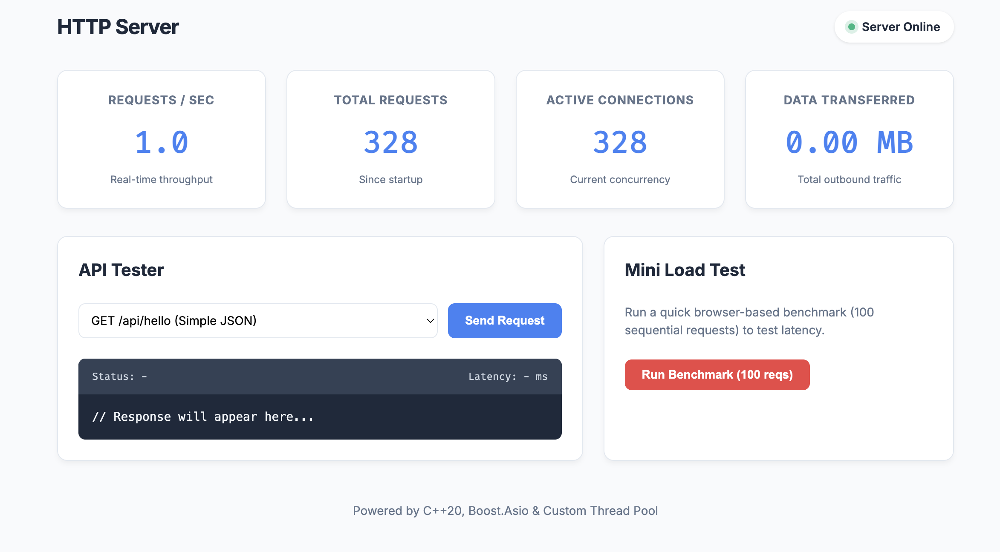
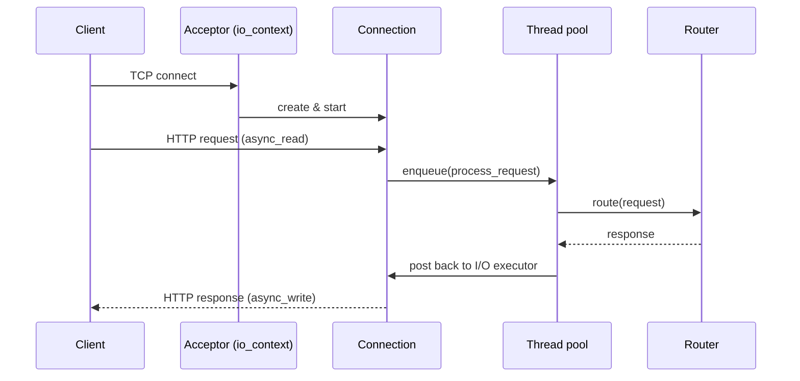

# C++20 HTTP Server — Boost.Asio, Thread Pool & Live Metrics Dashboard

[](https://github.com/MedinDev/HTTP_server/actions/workflows/ci.yml)
[](https://en.cppreference.com/w/cpp/20)
[](LICENSE)

An asynchronous HTTP/1.1 server written from scratch in modern C++20. It uses Boost.Asio for non-blocking networking, a custom thread pool for request handling, a regex-based router with path parameters and middleware, static file serving, and a built-in web dashboard showing live metrics.

**~24,000 requests/second with 1 ms p95 latency** on an Apple M1 Pro (see [Benchmarks](#benchmarks)).



## Features

- **Async I/O** — Boost.Asio `io_context` drives non-blocking accepts, reads and writes
- **Thread pool** — request handling runs on a fixed pool of worker threads (`std::packaged_task` + condition variable), keeping the I/O thread free
- **Router** — `GET`/`POST`/`PUT`/`DELETE` routes, path parameters (`/users/:id`) and a middleware chain
- **Static files** — serves a web root, with path-traversal protection
- **Live metrics** — atomic counters for requests, connections and bytes sent, exposed at `/api/metrics`
- **Web dashboard** — real-time metrics, an API tester and an in-browser mini load test
- **Tested** — GoogleTest unit and integration suites, run in CI on every push

## Quick start

Requirements: CMake 3.20+, a C++20 compiler, Boost, and GoogleTest (only for tests).

```bash
# macOS
brew install cmake boost googletest

# Ubuntu
sudo apt-get install -y cmake libboost-dev libgtest-dev
```

```bash
git clone https://github.com/MedinDev/HTTP_server.git
cd HTTP_server
cmake -B build -DBUILD_TESTING=ON
cmake --build build -j
./build/bin/HighPerformanceHttpServer -c config/default.conf
```

Then open <http://localhost:8080/> for the dashboard, or call the API directly:

```bash
curl localhost:8080/api/hello
curl localhost:8080/users/42
curl localhost:8080/api/metrics
```

Run the tests:

```bash
ctest --test-dir build --output-on-failure
```

## Usage

```cpp
using namespace http::server;

HttpServer server(config, logger);

server.router().get("/api/hello", [](const Request&) {
    return Response::json(R"({"message": "Hello, World!"})");
});

server.router().get("/users/:id", [](const Request& req) {
    return Response::json(R"({"user_id": ")" + req.path_params.at("id") + R"("})");
});

server.router().serve_static("/", "www");
server.start();
```

Configuration lives in [`config/default.conf`](config/default.conf):

```ini
port=8080
thread_pool_size=4
static_dir=www
log_level=INFO
```

## Architecture



| Component | Responsibility | Source |
| --- | --- | --- |
| `HttpServer` | Owns the `io_context`, acceptor, router, thread pool and metrics | [`src/server/http_server.cpp`](src/server/http_server.cpp) |
| `Connection` | One per client: reads, parses, dispatches to the pool, writes back | [`src/server/connection.cpp`](src/server/connection.cpp) |
| `Router` | Route matching, path parameters, middleware, static mounts | [`src/server/router.cpp`](src/server/router.cpp) |
| `ThreadPool` | Fixed worker pool returning `std::future`s | [`include/core/thread_pool.hpp`](include/core/thread_pool.hpp) |
| `Metrics` | Lock-free atomic counters read by the dashboard | [`include/server/metrics.hpp`](include/server/metrics.hpp) |

Class diagram: [`asset/class-diagram.png`](asset/class-diagram.png)

## Benchmarks

Measured with ApacheBench (`ab`) against `GET /api/hello`, 20,000 requests, Release build, 4 worker threads.
Machine: Apple M1 Pro (10 cores), macOS. Client and server on the same host.

| Concurrency | Requests/sec | p95 latency | p99 latency | Failed |
| ---: | ---: | ---: | ---: | ---: |
| 10 | 24,157 | 1 ms | 1 ms | 0 |
| 100 | 22,667 | 6 ms | 9 ms | 0 |

Resident memory after the run was about 3 MB.

Reproduce:

```bash
./build/bin/HighPerformanceHttpServer -c config/default.conf &
ab -n 20000 -c 100 http://127.0.0.1:8080/api/hello
```

The [Benchmarks workflow](.github/workflows/benchmarks.yml) runs the same test on every push to `main`.

## Design decisions

- **I/O and work are separated.** The Asio thread only moves bytes; handlers run on the pool, and results are posted back to the connection's executor. A slow handler can't stall other connections' reads.
- **Atomics for metrics.** Counters are `std::atomic` so worker threads update them without locks, and the dashboard reads them without blocking requests.
- **Regex compiled once per route.** Paths like `/users/:id` are turned into a `std::regex` when the route is registered, not on every request.
- **The router is a library.** Everything except `main.cpp` builds into `server_lib`, so tests and examples link the same code the server runs.

## Roadmap

- [ ] HTTP keep-alive (every request currently opens a new connection)
- [ ] Decrement `active_connections` when a connection closes
- [ ] Zero-copy static file serving with `sendfile`
- [ ] Benchmark comparison against nginx on identical hardware
- [ ] TLS support
- [ ] HTTP/2

## Project structure

```text
include/   Public headers (server, core, handlers, utils)
src/       Implementation
tests/     GoogleTest unit + integration tests, benchmark harness
www/       Dashboard (HTML/CSS/JS)
config/    Server and logging configuration
scripts/   Build, benchmark and profiling helpers
examples/  Minimal API and static-server examples
```

## License

[MIT](LICENSE)
